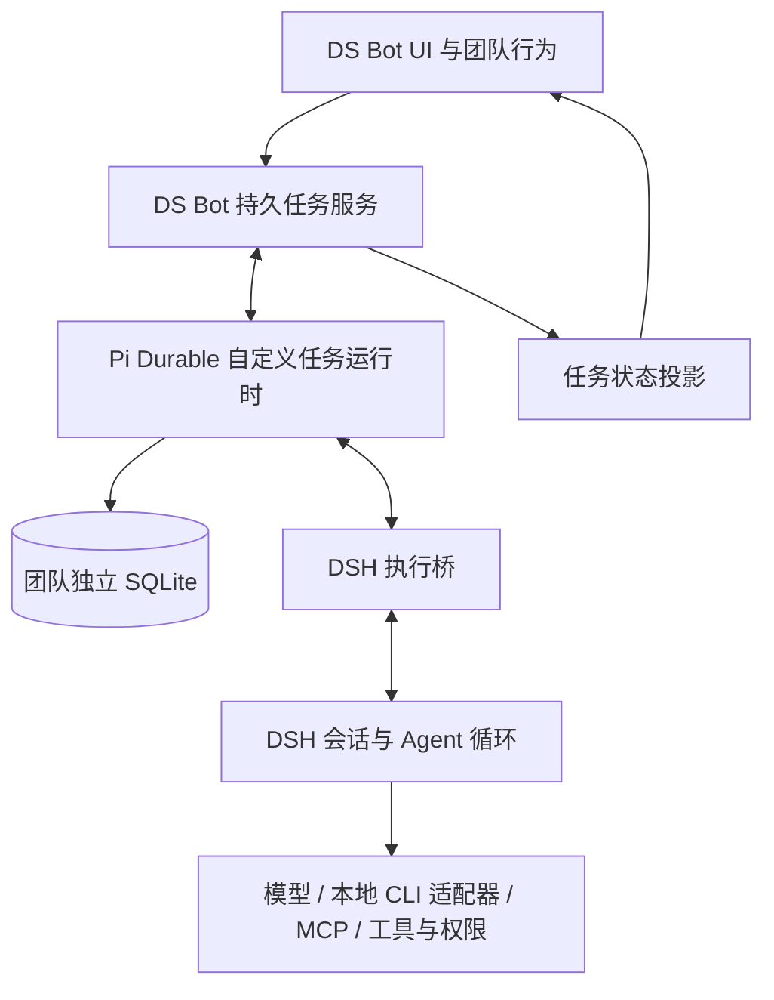

# 个人 fork：DeepSeek Harness 与 Pi Durable 集成设计

状态：集成原型已实现；实验功能默认关闭。隔离原型已验证真实 Pi 与 DSH 链路；不会修改用户已有团队数据。

## 目标与选择

实际引入 `@earendil-works/pi-durable`，复用它的持久任务运行时、检查点、子任务依赖、休眠与恢复能力。DeepSeek Harness（DSH）继续作为唯一的 Agent 执行引擎，负责模型循环、上下文、工具、权限与插件。DS Bot 保留团队身份、群聊、长期记忆、派活语义和界面。

本方案不是重新实现一套类似 Pi 的存储，也不是把 Pi 配成模型 Provider。集成通过 DS Bot 自己的 DSH 插件和公开接口完成，不修改 DSH，不读取其安装内部文件。

## 分工与接线



初期持久任务服务作为 Host 插件模块运行，与当前拥有团队写权限的 Host 同生命周期。先验证进程内集成，减少额外服务和 IPC。应用关闭后停止运行，重新启动才恢复；此集成本身不使 Mac 关机后仍可执行。

| 数据或行为 | 权威拥有方 |
|---|---|
| Bot、群、成员和团队权限 | DS Bot 现有团队状态 |
| 对话、上下文、模型请求、工具执行与审批 | DSH |
| 受管任务阶段、依赖、检查点、投递与结果账本 | Pi Durable |
| 任务状态在聊天与面板中的展示 | 只读投影，不独立驱动恢复 |

Pi 中只保存任务所需的输入、结果摘要和产物引用，不复制整个 DSH transcript。为管理任务创建的 Pi conversation 是管理范围，不向它提交需要启动 Pi generation 的用户输入。自定义任务通过执行桥调用 DSH。

## 实际依赖与公开 API

以已发布 `1.4.0` 为原型基线，评估固定版本的 `@earendil-works/pi-durable`、`@earendil-works/pi-ai` 和 `@earendil-works/chord`。Pi 的 Harness API 要求 models 对象；原型使用不注册模型 Provider 的 catalog，验证自定义任务可运行且没有 Pi 侧模型请求。不向 Pi 复制 DSH 密钥。

使用公开的 `Harness.open`、`createRegistry`、`defineExtension`、`defineTask`、`defineDoc`、事务中的 `tx.createTask`、SQLite 存储和恢复/观察接口。`createSession` 提供存储内核，但不能据此假设它单独包含任务调度器。启动自定义任务的最小公开 API 路径要通过原型验证。

休眠使用 `sleepUntil` 保存下一阶段；不把长时间等待留在进程内 Promise 里。DSH 外部事件的持久接收、如何使等待任务重新核对状态，需要验证公开 API。初版允许使用持久休眠后的有界核对，不臆造 Pi 的外部 signal API，也不调用私有调度器。

## 执行协议

每项受管工作有稳定 `workId`，对应 Pi task ID；一次执行有 `attemptId`，一次投递有稳定 `deliveryId`。映射同时保存 `botId`、当前 DSH `sessionId`、现有 `exchangeId`，以及能从公开事件取得的消息、回合标识。DSH 会话换到新 part 时迁移映射，保持工作身份。

逻辑流程为：

1. 在 Pi 事务中保存工作、投递意图及待发送记录。
2. 在事务之外通过执行桥调用 DSH；保留现有队列、steer 和权限语义。
3. 从 DSH 公开会话事件与可核对记录确认接收，保存投递回执。
4. 将规范化的执行进展、子任务关系、审批等待和业务完成写回 Pi。
5. 在 Pi 事务中记录结果与回传意图，通过执行桥送回发起 Bot，再记录可核对的回执。

`turn/end` 是执行事件，不直接等于工作完成：当前代码还有等待子任务、失败、延后结果、切换会话及重新执行等情况。Pi 的父子任务和等待方式应保留现有 DS Bot 的结果归属；默认等待所有相关结果，不擅自改成一个失败就取消所有 Bot。

同一 DSH 会话的排队与执行顺序继续服从 DSH。Pi 可同时管理多项任务，不代表同一会话可以并行执行多个 Agent 回合。

## 一致性、取消与恢复

Pi SQLite 和 DSH 会话不是一个事务。采用持久待发送账本、稳定关联 ID 和启动核对，目标为至少一次派发加可验证去重。Pi 的 `requestId` 去重不等于 DSH 会原子拒绝重复输入；现有 `source.exchangeId` 只能先作为关联凭据。

崩溃发生在 DSH 已接收、Pi 尚未保存回执之间时，先核对 DSH 已提交消息、当前收件箱和任务结果，再决定是否重发。公开接口无法确定时标记为“需核对”，不自动重复可能产生副作用的工作。跨系统 exactly-once 不作承诺；需要更强 admission 保证时向 DSH 提公开接口需求。

取消先写取消意图，再停止对应执行，收到停止确认后才能完成取消。一个任务取消不能误停同会话的无关工作。旧执行的迟到结果按 attempt 标识隔离。停止失败或工具仍运行时，状态必须如实显示，不能仅把 Pi task 标为取消就声称外部操作已停止。重启后的旧审批不自动沿用授权。

受管工作只由 Pi 协调恢复；`resume.js` 的旧恢复器仅处理未迁移工作。不能让两个恢复器同时重发同一项任务。恢复粒度初期为任务、派发、回合和明确业务阶段；观察到工具事件不代表能够从 DSH 内部工具检查点续跑。本地 Codex/Antigravity CLI 的内部恢复也不因外层 Pi 集成自动获得保证。

## 对当前模块的改动范围

| 模块 | 集成职责 |
|---|---|
| 新增 `src/host/durable/` | Pi 生命周期、自定义任务/文档、存储、执行桥、核对和状态投影 |
| `handoffs.js` | 为受管工作建立任务映射；保留现有派活规则和结果归属 |
| `delivery.js` | 接入持久投递账本与回执，复用 DSH 公开发送接口 |
| `turns.js` | 产出规范化工作事件，明确完成与等待的区别 |
| `resume.js` | 按持久 ownership 划分新旧恢复责任 |
| `store.js` | 沿用团队单写者限制；受管任务不再维护第二份权威 `state.works` |
| `parts.js` | 更新任务与当前会话的映射 |
| `channel.js` 与客户端 | 通过现有 API 提供任务状态、核对、取消和重试入口 |

Pi 数据文件跟随应用自己的团队数据目录，不放到 `~/.dsh`。只有获得团队写权限的 Host 打开并驱动 SQLite；只读 Host 不启动调度。桌面端数据迁移/备份须覆盖该文件及 SQLite 的关闭或一致备份流程，不在运行中随意复制数据库。Node/Electron Host 的 SQLite 运行支持和打包依赖单独验证。

## 当前已接入的实验范围

- 已实际引入固定版本的 Pi Durable、Pi AI 和 Chord `1.4.0`，使用真实 SQLite 与自定义任务；Pi 不注册模型 Provider，不执行第二套 Agent 循环。
- 新的 `src/host/durable/` 包含任务运行时、公开 DSH 执行桥和插件生命周期封装。
- `durableTasks: true` 或保存的启用偏好显式启用；默认关闭时不打开任务数据库、不调度任务。设置 → 持久任务提供显式开启、模型选择、分步任务创建、进度与结果查看。Bot 私聊通过 `create_durable_task`、`get_durable_task`、`list_durable_tasks` 使用同一运行时。
- 通过现有认证的 `POST /api/bot` 调用 `durable-submit` 与 `durable-state`。输入形式为 `{ key, steps: [{ sessionId, prompt }] }`；每项工作最多 20 阶段，原型索引最多 1000 项。
- 仅接收团队普通 DSH Agent 的专用会话，不接收 Bot、群聊或外来会话。每个阶段使用单独会话，持久预留，不能被另一工作复用。会话应为空闲的新会话；未知输入、队列干扰及历史不完整会使任务进入需核对状态。
- 手动创建的任务使用所选 DSH 模型和普通会话权限；从 Bot 私聊创建的任务保存发起者的模型、工作目录、说明和受支持权限预设。当前不迁移 `handoffs.js`；Pi 管理受管工作和结果回传，Bot 原有回合恢复仍由 `resume.js` 管理，双方不重发同一投递。
- 任务库位于团队目录 `durable/tasks.sqlite`。只有团队写者打开运行时；只读 Host 不打开它。任务服务随 Host 关闭并等待 SQLite 关闭。
- DS Bot 的会话归档/Agent 删除与任务提交共用变更门。活动或需核对的受管工作会阻止这些 DS Bot 操作；原生 DSH 外部操作仍可能使目标失效，届时停止核对而不盲目重发。
- 创建阶段中断可通过“继续准备”或私聊中的原任务 key 恢复已保存分配；后续阶段会带上有界的前序结果。私聊可通过 `cancel_durable_task` 取消任务；执行歧义的手动消除、任务清理与完整 Bot 派活迁移尚未提供。聊天中的任务创建工具复用同一受管执行入口，普通问答和 Bot 间派活继续使用原流程。关闭开关不会删除 SQLite；重新启用会核对在途工作。

开发验收命令（需要 Node 22.19+、桌面应用依赖以及 loopback 监听权限）：

```sh
cd ds-bot
npm ci
npm run harness
node dev/durable-smoke.mjs
node dev/durable-api-smoke.mjs
node dev/durable-chat-smoke.mjs
npm test
npm run lint
node scripts/build-client.mjs --check
```

所有原型都只允许 `.dsh-test-durable-*` 目录和 loopback mock。运行结束关闭所启动的进程，不读取真实聊天或凭据。运行时与执行桥有 SQLite/公开接口单元测试；进程测试覆盖检查点恢复，不保证任意 DSH 模型或工具内部指令级续跑。

## 本次验证结果

- Pi/DSH 进程测试：4 项通过。包含实际模型与工具调用、重复提交、Pi 在 DSH 接收后 SIGKILL、双方在已提交阶段边界重启，以及 DSH 执行中断后停止核对且不重发。
- 项目认证 API 冒烟通过：任务创建、查询、去重、冲突和非专用会话拒绝、在途会话保护，以及 Host 重启后任务及结果保留。
- 新增 22 项针对性测试通过；全插件 1040 项中 1038 通过、2 跳过。
- 桌面端 123 项中 122 通过、1 跳过；原有 52 步 mock 冒烟全部通过。
- lint、生成文件一致性、源码隐私扫描与差异空白检查通过。

SQLite 除沿用团队写权限之外还持有独立写者锁，避免同一存储被两个任务运行时驱动。DSH 模型适配器继续固定原有 Pi AI 1.1.0，持久任务运行时独立使用 1.4.0。投递前历史发生变化时保留未接收状态并重新核对，不生成虚假的已发送回执。

## 分阶段落地与验收

1. **独立集成原型**：在隔离目录真正安装固定版本依赖，使用 Pi 的公开 API 创建、等待、取消和恢复自定义任务。使用 mock DSH executor；证明不会触发 Pi 的模型循环。
2. **DSH 单任务贯通**：在专用 mock 测试团队通过公开接口派发任务、记录回执与业务结果。测试关键崩溃窗口和不能确定时的核对状态。
3. **团队协作贯通**：Chief 派两个 Bot 工作，等待汇总，重启后保持依赖和归属；测试同会话排队、分段、审批、取消与迟到结果。
4. **受控迁移**：按工作持久 ownership 启用 Pi；旧工作继续旧恢复路径，新工作只走新路径。切换前备份，在途任务未处理完前禁止简单关开功能使其丢失。

必须验证：

- Pi 任务创建与 DSH 接收之间每个崩溃窗口均可辨认；无法辨认时不会盲目重发。
- 已完成业务阶段不重复，剩余工作恢复或明确进入需核对状态。
- 子任务结果不会丢失；通过回执/去重协议验证汇总回传不会重复。
- 取消、重试、审批与同会话无关工作互不混淆。
- 存储故障、重复启动和崩溃循环均有明确状态；只有单个写者运行。
- 不访问用户真实聊天、凭据或数据，所有测试使用 mock 与独立目录。

此阶段只形成设计。实现前以原型确认 DSH admission/查询能力和 Pi 外部事件衔接路径；若公开能力缺失，列明所缺接口，不修改 DSH 内部实现绕过。

## 参考

- [Pi Durable 1.4.0 README](https://github.com/earendil-works/pi/blob/v1.4.0/packages/durable/README.md)
- [Pi 公开导出](https://github.com/earendil-works/pi/blob/v1.4.0/packages/durable/src/index.ts)
- [Pi Harness 选项与类型](https://github.com/earendil-works/pi/blob/v1.4.0/packages/durable/src/harness/types.ts)
- [Pi 1.4.0 更新记录](https://github.com/earendil-works/pi/blob/v1.4.0/packages/durable/CHANGELOG.md)
- [DS Bot 派活设计](2026-10-16-bot-handoffs.md)
- [DSH 接口约束与让步记录](2026-10-13-dsh-concessions.md)

## 日常分支体验入口（2026-10-25）

设置中的“持久任务”页面使用已保存的显式启用偏好，不需要编辑用户的 DSH 配置。创建接口先持久化定义，再逐阶段分配专用会话和选定模型；重复提交复用原工作，分配中断后可继续准备。后续阶段接收最多 12000 字符的前序结果参考，总输入仍限制在 32000 字符内。失败状态保留之前已保存的结果。

执行桥暂时观察到未匹配的启动/接收活动时，只做有界核对，不投递新输入；超过观察期限进入需核对状态。真实 API 测试已覆盖保存偏好后的 Host 阶段边界 SIGKILL 和自动恢复。打包版在独立 mock 数据中验证了开启、创建、两阶段完成与结果查看。

## 私聊派活入口（2026-10-25）

开启实验功能后，Bot 根据任务性质判断是否需要 `create_durable_task`，而不是将所有执行请求转为持久任务。简单有界的查询、读文档、检查命令和单步小操作直接在当前聊天完成；只有保存进度、中断恢复或跨较长外部等待继续执行有明确价值，或用户明确要求持久化执行时，才传入任务名和 1 至 20 个完整阶段。工具调用、多个步骤或需要用户确认本身都不是持久化条件；恢复价值不明确时留在聊天。Bot 自行判断执行方式，不另行询问是否使用持久化，但原有权限确认和业务澄清保持不变，用户明确要求在聊天中直接执行时也应尊重。简单问答、团队管理和需要团队专用工具的工作继续留在原对话。模型根据上下文、提示词与工具说明选择入口，不对用户文字做关键词或步骤数拦截。工作创建成功后 Bot 结束当前回合，聊天中的任务卡只读取 Pi 检查点显示进度，不用轮询模型或新建进度回合。

创建者身份由执行中的 Bot 会话推导，工具参数不能指定其他 Bot、模型、权限或会话。新任务 key 由 Bot、当前会话和工具调用 ID 派生；同一调用重试复用原工作。显式传入已有 key 只允许原 Bot 恢复原定义，不能用来改变输入。查询工具也只返回该 Bot 私聊发起的工作。群聊、转发、恢复回合和任务结果回传不得创建新的持久任务。

DSH 工作会话使用公开接口创建，继承实际选中的模型与思考级别、工作目录、Bot 说明和可复用权限预设。说明和阶段一起限制在 32000 字符，前序输出按现有预算传递。每次派发重新核对保存的目录和权限预设内容；定义漂移或无法还原则停止核对。工作会话的团队工具列表包含这三个持久任务工具，确保不能递归建任务、修改团队或绕过 Bot 权限。Bot 专用能力绑定、Auto review 和自定义会话权限暂不继承；不支持时先拒绝创建，Bot 说明具体原因，不能为了执行自动扩大权限。

原始聊天身份、执行上下文、会话分配和任务定义在 Pi 同一创建记录中保存。Host 重启时继续准备尚未提交的聊天任务。终态结果通过独立回传器送回发起 Bot 的当前对话分段，由 Bot 使用保存结果回复用户；任务中途的失败也携带已完成的阶段结果。发起者被删除或来源不是私聊时不改投其他会话。

回传采用稳定 `exchangeId`，先保存投递尝试与目标会话，再调用公开发送接口并 flush，最后保存回执。重启或发送异常后核对保存目标的收件箱和公开历史，即使 Bot 已进入新分段也先查原目标。无法证明已接收时标记回传需核对，不盲目重发。`resume.js` 不保存或重发 `durable` 角色的回传消息，避免旧恢复器与 Pi 账本争用；已开始的 Bot 报告回合仍沿用原有回合恢复。聊天任务卡和设置列表展示回传异常，已保存结果始终可查看。

执行上下文从公开控制器解析的真实 Agent 获取，不使用工具调用中的窄执行引用来枚举权限和工具。工具展示可能是 PTC 的 `run_code`；使用公开 `schemas` 与 `get` 核对可调用面，拒绝团队、目标和阻塞提问工具，并为内层调用安装单调 guard。限制使用明确的 deny 列表，不能从根级工具列表构造 allow 掩码，否则会误删 preset 祖先提供的文件和命令工具。恢复检查与 `agent/pre-step` 都恢复保存的边界，覆盖已接收但尚未完成的阶段。已经由公开历史证明完成的阶段仍可保存结果，后续阶段遇到范围漂移则停止。

投递成功或收件箱中的消息只记为 `queued`；只有公开历史中的对应 `user/message` 才证明 Bot 已消费并最终记为 `delivered`。正常退出可能取消排队消息，因此排队回传也要在重启后继续核对。收件箱与历史的短暂交接允许 15 秒观察，仍无法确认时展示需核对；附件准备失败则保存 `unavailable`，避免每秒静默重试。聊天卡在任务完成但尚未消费回传时显示等待 Bot 回复。

聊天入口验收：9 项真实 DSH/Pi 流程通过，含实际读取工作目录文件、阶段传值、模型与工具范围继承、私聊查询、同 key 去重、跨 Bot 拒绝、检查点 SIGKILL 恢复、已接收输入后的 SIGKILL 核对，以及正常退出后不重复回传。插件 1083 项测试中 1081 通过、2 跳过；原有 52 步 mock 回归通过。打包版使用全新 mock 数据确认任务卡显示两步保存并收到原 Bot 的结果回复。

## 聊天取消（2026-10-25）

用户在原 Bot 私聊中说“停止”时，Bot 直接调用 `cancel_durable_task`，不再创建后台任务去执行取消。已有 key 必须属于当前 Bot；省略 key 时优先选择唯一的活动任务，没有活动任务时可处理唯一待核对任务。多个任务会返回选项供用户确定，不能猜测或一次全停。后台回传不能自行取消任务，但当前回合加入了真实用户消息时可以处理用户的停止指令。

活动任务使用 Pi 公开的 `Harness.abortTask` 持久化取消标记，停止正常阶段推进，再由 abort handler 调用 DSH 停止桥。尚未提交的准备记录保存取消标记，启动恢复和 key 重试都不得重新分配或提交它。执行会话同时设置工具 guard 和 pre-step 门，取消后的迟到通知、后续模型步骤和工具调用不得继续工作；重启时按 Pi 取消标记恢复这个门。

停止桥先用公开历史和收件箱确认该专用会话仍只承载自己的输入；有外来工作或无法确认归属时拒绝误停。使用 Agent `cancel` 和 `whenIdle` 停止并等待整个 Agent，使用 `subagents.drainDescendants` 收拢其后代，使用 jobs 的 owner 参数停止并等待该会话自己的后台工作。job 需要 `job/settled` 中的 producer 回执，不能只凭一个被强制标记的终态声称进程退出。停止核对有 10 秒上限；不能确认时结果为 `CANCEL_UNCONFIRMED`，界面显示可能仍在运行，并保留会话保护。

确认停止后 Pi 结果为 `aborted`，保留已完成阶段的结果，后续阶段不派发。对已经进入核对失败终态的工作，单独保存确认停止的回执，保留原 Pi 失败记录以供审计。已经完成的任务不再干预其会话。取消不撤销之前已经完成的文件修改或外部操作。

新增验收覆盖取消与 DSH 接收的竞态、取消中关闭后恢复、准备中取消、多个任务与跨 Bot 隔离、工具不退出时不误报成功、子任务及 job 的归属与回执。实际聊天测试以“停止”取消运行中的 shell，确认进程会话空闲、结束标记未写入、下一阶段未启动，重启后仍取消。插件 1098 项中 1096 通过、2 跳过；真实聊天冒烟包含原有 9 项及新增取消流程。


## 聊天暂停与继续（2026-10-25）

新增 `pause_durable_task` / `resume_durable_task`，沿用当前 Bot 私聊、真实用户请求、归属校验与变更串行门。暂停请求写入 Pi 的任务文档；已经被 DSH 接收的阶段先完成并保存结果，再暂停于下一阶段。不能安全核对的中断仍进入需核对状态，不能用“继续”盲目重发。

暂停在自定义 Pi 工作流阶段中通过公开 `runtime.commit` 原子保存进度、创建自有 pause gate 子任务，并提交 `waiting/allSettled`。gate 用公开 `sleepUntil` 长期等待；不占模型请求、不循环检查 DSH。继续先保存撤销暂停标记，再通过公开 `Harness.abortTask` 结束 gate，使原工作流继续。启动时修复清除标记和释放 gate 之间的崩溃窗口。gate 的取消只是释放等待，不取消 DSH 已完成阶段。工作流自身取消会连同 gate 一起结束，取消、失败与需核对终态不得恢复。

准备中的任务也能暂停，重启不自动补分配；继续复用保存的同一分配记录。多个匹配任务返回选择而不猜测。暂停标记、等待阶段、已保存结果均在 SQLite 中；界面明确区分“当前步骤完成后暂停”和“已暂停”，在当前步骤完成前不声称工具已冻结。暂停中的专用执行会话在 pre-step 门拒绝后续工作；当前已接收阶段仍可完成，继续时重验原权限与工具范围。

验收覆盖暂停期间 DSH admission、阶段边界、重启后保持等待、继续只执行剩余阶段、准备暂停、多任务与跨 Bot 隔离、后台报告禁止控制、暂停后取消及终态禁止继续。真实聊天通过“先暂停”和“继续”调用工具，验证第一阶段 shell 仅执行一次、第二阶段在重启后仍未开始，继续后携带前序结果完成。

本轮验证：插件 1108 项中 1106 通过、2 跳过；原有 52 步 mock 回归全部通过。真实聊天完成暂停、Host 重启保持暂停、继续只运行剩余阶段的全流程，另以公开 Pi 文档事务复现“已保存继续标记但 gate 尚未释放”的崩溃窗口并验证启动修复。打包后的界面显示已暂停 1/2 步，继续后完成 2/2 步。
